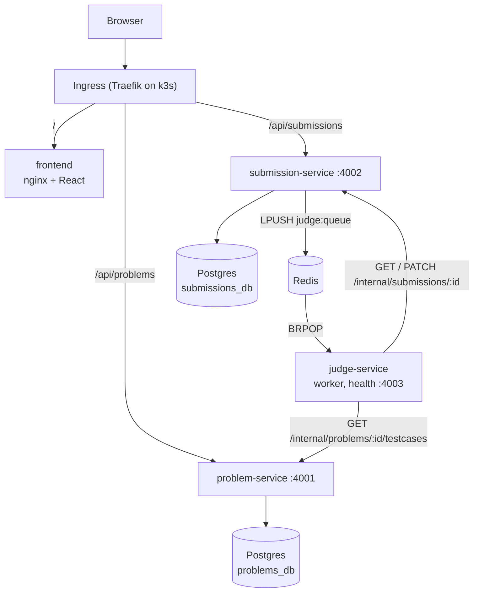

# CodeArena

An online C++ judge built as microservices: browse problems, write C++17 in the browser, and get a verdict (Accepted, Wrong Answer, Time Limit Exceeded, Runtime Error, Compilation Error) in seconds.


<!-- Placeholder: add a screenshot at docs/screenshot.png -->

**Live demo:** `http://<elastic-ip>.nip.io` (printed by `terraform output app_url`)

## Architecture



- **Database per service:** one Postgres server with two separate databases.
- **Asynchronous judging:** submissions are queued in Redis. Judge workers pull one job at a time and scale from 1 to 3 pods.
- **Internal routes:** `/internal/*` routes require an `X-Internal-Token` header and are never exposed by the Ingress or nginx.
- **Language:** C++17 only.

## Tech stack and rubric mapping

| Rubric item | How CodeArena covers it |
|---|---|
| Microservices | problem-service, submission-service and judge-service (Node 20, Express), plus the frontend; Redis queue; database per service |
| Docker | Multi-stage, non-root images for all 4 services; `docker-compose.yml` for local development |
| IaC | Terraform in `infra/terraform`: EC2, security group, Elastic IP, key pair, k3s bootstrap |
| Kubernetes | Kustomize base and overlays: Deployments, StatefulSet, Services, Ingress, HPA, NetworkPolicy, probes, limits |
| CI/CD | GitHub Actions: secrets scan, test, IaC scan, build, image scan, push to GHCR, deploy, DAST |
| DevSecOps | Gitleaks, npm audit, CodeQL, Trivy (image and IaC), OWASP ZAP, Dependabot, hardened judge sandbox |
| Cloud | AWS EC2 (`t3.small`, `ap-south-1`) running k3s |
| Public link | `http://<elastic-ip>.nip.io` |

## Repository layout

```
services/problem-service      problems and test cases (Postgres: problems_db)
services/submission-service   submissions API and job queue (Postgres: submissions_db, Redis)
services/judge-service        sandboxed compile and run worker, plus samples/ for demos
frontend                      React + Vite + Tailwind, served by nginx
k8s                           Kustomize base, local overlay and prod overlay
infra/terraform               AWS infrastructure
.github                       CI/CD pipeline, CodeQL, Dependabot
```

## Run locally with Docker Compose

Requirements: Docker Desktop (WSL2 backend on Windows) and Node 20.

```bash
cp .env.example .env          # set POSTGRES_PASSWORD and INTERNAL_TOKEN
docker compose up --build -d --wait
```

Open http://localhost:8080. The APIs are also published directly on `localhost:4001` and `localhost:4002`.

To get each verdict from the command line:

```bash
cd services/judge-service/samples
node submit.mjs ac.cpp  sum-of-two-numbers      # Accepted
node submit.mjs wa.cpp  maximum-subarray-sum    # Wrong Answer (int overflow)
node submit.mjs tle.cpp count-primes            # Time Limit Exceeded
node submit.mjs re.cpp  sum-of-two-numbers      # Runtime Error
node submit.mjs ce.cpp  sum-of-two-numbers      # Compilation Error
```

Run the tests with `npm test` in each service folder, and build the frontend with `npm run build` in `frontend/`.

## Run on a local Kubernetes cluster

See [k8s/README.md](k8s/README.md). It uses k3d, builds the images with compose, imports them, creates the secret and applies `k8s/overlays/local`.

## Deploy to AWS (runbook)

**Prerequisites:**
- Terraform 1.6+ and AWS CLI v2, with credentials set up via `aws configure`.
- An SSH key pair: `ssh-keygen -t ed25519 -f ~/.ssh/codearena`.
- A public GitHub repo with Actions enabled.

1. **Create the server.**
   ```bash
   cd infra/terraform
   cp terraform.tfvars.example terraform.tfvars   # paste ~/.ssh/codearena.pub into public_key
   terraform init
   terraform plan
   terraform apply
   terraform output              # public_ip and app_url
   ```
   Wait about 2 minutes for k3s to install, then check it:
   ```bash
   ssh -i ~/.ssh/codearena ubuntu@<public_ip> 'sudo k3s kubectl get nodes'
   ```
   The node should show `Ready`.

2. **Add the GitHub secrets** under Settings → Secrets and variables → Actions:

   | Secret | Value |
   |---|---|
   | `EC2_HOST` | the `public_ip` output |
   | `EC2_USER` | `ubuntu` |
   | `EC2_SSH_KEY` | the full contents of `~/.ssh/codearena` (the private key) |
   | `POSTGRES_PASSWORD` | a strong password |
   | `INTERNAL_TOKEN` | a long random string, for example `openssl rand -hex 24` |

   GHCR uses the built-in `GITHUB_TOKEN`, so no registry secret is needed. Also create an environment called `production` under Settings → Environments. The deploy job uses it.

3. **Push to `main`.** The pipeline scans, tests, builds and pushes the images to GHCR.

4. **Make the GHCR packages public.** After the first push, open each of the 4 `codearena-*` packages under your GitHub profile → Packages → Package settings → Change visibility → Public. k3s pulls the images without credentials, so they must be public. Then re-run the failed **deploy** job, or push again.

5. **Open `app_url`** and submit `services/judge-service/samples/ac.cpp` to *Sum of Two Numbers*.

> **Avoid AWS charges:** run `terraform destroy` in `infra/terraform` when you are finished. The Elastic IP and EC2 instance are billed while they exist.

## CI/CD pipeline

`.github/workflows/pipeline.yml` runs on every push and pull request to `main`:

| Job | What it does | Runs on |
|---|---|---|
| secrets-scan | Gitleaks over the full git history (official Docker image) | push, PR |
| test | For each of the 4 packages: `npm ci`, then `npm test` (frontend: `npm run build`), then `npm audit --audit-level=high --omit=dev` | push, PR |
| iac-scan | Trivy config scan of `infra/` and `k8s/`; fails on HIGH or CRITICAL. Accepted risks are in `.trivyignore` | push, PR |
| build-scan-push | Buildx build with GitHub Actions cache, Trivy image scan (SARIF to the Security tab, fails on fixable CRITICAL), push to GHCR as `:<sha>` and `:latest` | main only |
| deploy | `kustomize edit set image` to the commit SHA, render `k8s/overlays/prod`, copy it over SSH, update the secret, `k3s kubectl apply`, wait for every rollout | main only |
| dast | OWASP ZAP baseline scan of the public URL; the report is uploaded as an artifact, and warnings do not fail the run | main only |

`codeql.yml` runs CodeQL for JavaScript on push, on pull requests and weekly. `dependabot.yml` opens weekly update PRs for npm, Docker and GitHub Actions.

## Security

**Judge sandbox.** Every test runs under:
- `prlimit` limits for memory (address space), CPU seconds, process count (64) and file size (10 MB);
- a wall-clock kill at the time limit plus 500 ms;
- a 1 MB stdout cap;
- a separate process group, killed after every run;
- an environment containing only `PATH`, so secrets never reach user code;
- `tini` as PID 1, which reaps orphaned processes.

The judge also runs with a read-only root filesystem and a writable `/tmp` only (an `emptyDir` with a 200Mi limit in Kubernetes, a tmpfs in compose).

**Containers.**
- All images run as non-root.
- Every Kubernetes container sets `runAsNonRoot`, drops all capabilities, sets `allowPrivilegeEscalation: false`, uses the `RuntimeDefault` seccomp profile and has a read-only root filesystem.
- Every container has CPU and memory requests and limits, plus readiness and liveness probes.

**NetworkPolicy.**
- The judge can reach only problem-service, submission-service, Redis and DNS, so submitted code cannot reach the internet.
- Postgres accepts connections only from the two services that own its databases.

**Application.**
- Internal routes need `X-Internal-Token`, compared in constant time, and they are never routed publicly.
- Submissions are rate limited to 10 per minute per IP.
- Input is validated, and code is limited to 64 KB.
- Database queries are parameterised.
- `helmet` adds security headers on the APIs.
- nginx sends CSP, X-Frame-Options, nosniff, Referrer-Policy and Permissions-Policy headers.

**Secrets.** No secrets are kept in git. Use `.env` (gitignored), `terraform.tfvars` (gitignored), the Kubernetes secret created at deploy time, and GitHub Actions secrets. Gitleaks checks every push.

**Pipeline scans.** Gitleaks, npm audit, CodeQL, Trivy (IaC and images), OWASP ZAP and Dependabot.

## Demo script

1. Open the public URL. Show the problem list, the dark/light toggle and a phone-width layout.
2. Submit the 5 files from `services/judge-service/samples/` to get AC, WA (4/6), TLE (4/6), RE and CE with the compiler message.
3. Show a pipeline run in GitHub Actions, the Trivy results in **Security → Code scanning**, and the ZAP report artifact.
4. On the server, run:
   ```bash
   sudo k3s kubectl get pods,hpa -n codearena
   ```
5. **Autoscaling:** submit `tle.cpp` from two or three browser tabs (each IP is limited to 10 submissions per minute). Then watch the judge scale:
   ```bash
   sudo k3s kubectl get hpa,pods -n codearena -w
   ```
6. Finish with `terraform destroy`.
